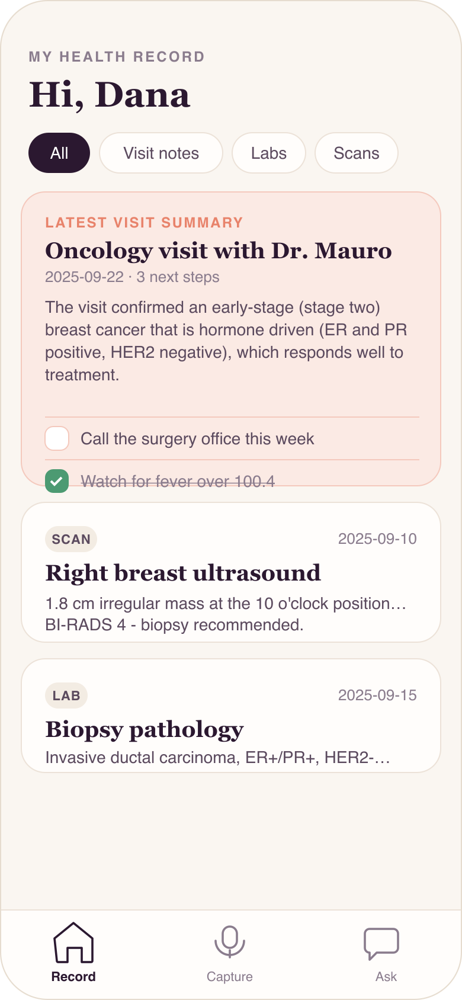
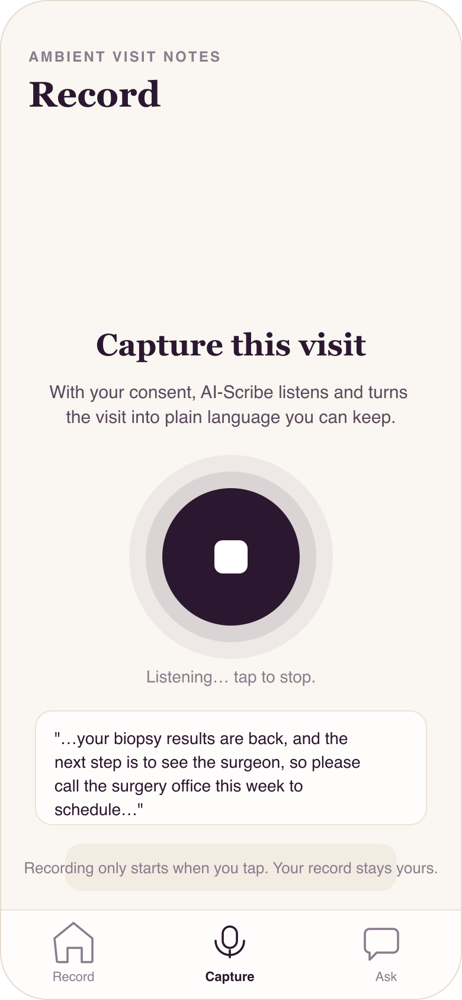
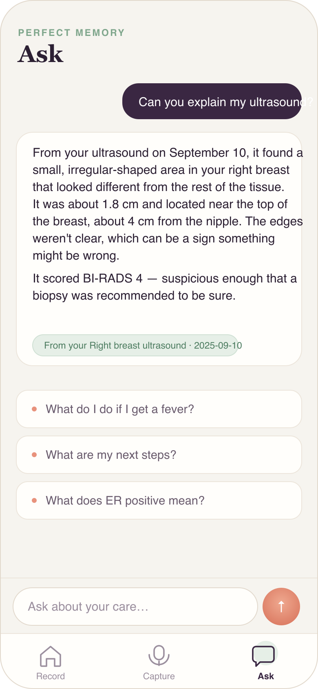

# AI-Scribe

**The patient's AI scribe** - an interactive, patient-owned health record that captures each visit (with consent) and joins it with labs and scans, in plain language.

> Built by Team 19 (Matthew Willer, Einav Kotler, Kanta Garg) around the question:
> *How might we improve how conditions get diagnosed?* Focus: breast cancer, from the first lump to a confirmed diagnosis.

AI-Scribe is **fully open source** (Apache-2.0) and **vendor-neutral**. It runs entirely on your own machine with local open-source models, or against any OpenAI-compatible API endpoint. No proprietary service is required.

**Try the live demo: https://ai-scribe-demo-185.netlify.app** - a static build with a bundled sample record so you can explore every screen from a link. Answers in the demo are pulled from the sample record, not a live AI model; run it locally (below) for real transcription and grounded LLM answers.

## Why

From 15+ interviews with patients, survivors, and clinicians, three problems stood out:

- **Too much to take in.** Patients absorb news only after leaving the visit; post-op instructions don't stick.
- **Notes patients can't use.** Portal notes are too technical. One patient read "triple-positive" alone, after hours.
- **Records are scattered.** Patients hand-carry CDs between hospitals and get re-scanned when images don't transfer.

## What it does

1. **Ambient visit notes** - with consent, records a visit, transcribes it, and writes a plain-language summary, clear next steps, and a shareable caregiver update.
2. **One patient-owned record** - joins visit notes with labs, scan reports, and discharge summaries in a single timeline the patient owns. Swipe a record left to delete it (with confirmation) if it was captured by accident - the note, its summary, and its retrieval data are all removed.
3. **Ask it anything** - a chat that answers questions grounded *only* in the patient's own record, with citations back to the source document (e.g. "From your Sep 22 visit").

## Demo

A mobile-first web app. The three tabs below run against real local models (Ollama `llama3.1` for the LLM, `faster-whisper` for transcription, `sentence-transformers` for retrieval) - no cloud, no API keys.

| Record | Capture | Ask |
| :---: | :---: | :---: |
|  |  |  |
| The unified record: visit notes, labs, scans, discharge. | Consent-first ambient capture, then a plain-language summary. | Grounded Q&A that cites the source in your record. |

The answers and summaries shown are real output from `llama3.1` running locally on the seeded demo patient.

## Architecture

```
ai-scribe/
├── backend/          FastAPI + SQLite. Pluggable AI providers.
│   └── app/
│       ├── providers/    Transcription, LLM, and embedding provider interfaces
│       ├── services/     Visit summarization, RAG, ingestion
│       ├── routers/      HTTP API
│       └── models.py     SQLModel data models
└── frontend/         React + Vite + TypeScript. Matches the product mock.
```

### Pluggable AI providers

Everything AI-related sits behind an interface so the project stays open and portable:

| Capability     | Local / open-source default        | Alternative                          |
| -------------- | ----------------------------------- | ------------------------------------ |
| Transcription  | `faster-whisper` (runs on-device)   | Any OpenAI-compatible `/audio` API   |
| LLM            | Ollama (e.g. `llama3.1`)            | Any OpenAI-compatible `/chat` API    |
| Embeddings     | `sentence-transformers` (on-device) | Any OpenAI-compatible embeddings API |

Choose the provider with environment variables - see `backend/.env.example`.

## Quick start

### Backend

```bash
cd backend
python -m venv .venv && source .venv/bin/activate
pip install -r requirements.txt
cp .env.example .env        # edit to pick your providers
uvicorn app.main:app --reload --port 8000
```

Seed the demo patient ("Dana"):

```bash
python -m app.seed
```

Running fully locally with open models (no cloud, no keys):

```bash
# 1. LLM via Ollama
brew install ollama            # or see https://ollama.com
ollama serve &
ollama pull llama3.1

# 2. Local transcription + embeddings
pip install faster-whisper sentence-transformers

# 3. Point the backend at them (backend/.env)
AISCRIBE_LLM_PROVIDER=ollama
AISCRIBE_TRANSCRIBE_PROVIDER=faster_whisper
AISCRIBE_EMBED_PROVIDER=sentence_transformers

# If you switch embedding models after seeding, rebuild the vectors:
python -m app.reindex
```

### Frontend

```bash
cd frontend
npm install
npm run dev                 # http://localhost:5173
```

## Privacy & safety

- The record is **patient-owned** and stored locally by default (SQLite + on-disk files).
- Ambient capture is **consent-first**: recording only starts on an explicit action.
- AI answers are **grounded and cited**: the chat only uses the patient's own documents and links back to the source.
- This is a **prototype for research and demonstration**. It is not a medical device and does not provide medical advice.

## Design document

For a full build-from-scratch guide - architecture, data model, API, the AI-provider
abstraction, and the calm design system - see [docs/DESIGN.md](docs/DESIGN.md).

## Contributing

Contributions are welcome. See [CONTRIBUTING.md](CONTRIBUTING.md).

## License

[Apache-2.0](LICENSE). Copyright 2026 AI-Scribe contributors.
